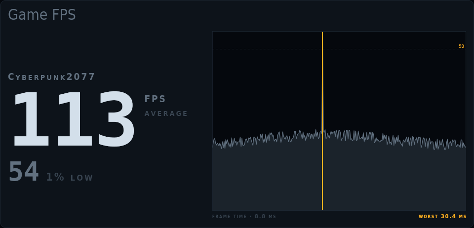
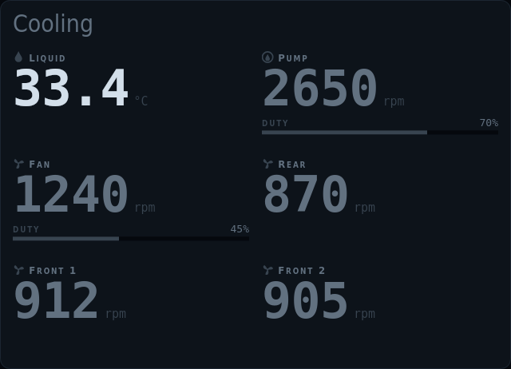

# kiosko-plugin-gaming

Game FPS, 1 % low and frame times (MangoHud, PresentMon), and the cooling: fans, pumps and coolant (liquidctl, lm-sensors, LibreHardwareMonitor).

A plugin for [Kiosko](https://github.com/kiosko-lcd/kiosko), the widget mosaic for small USB LCD panels. **Optional:** Kiosko doesn't install it.



## Install

In Kiosko, **Plugins → Install from npm** → `kiosko-plugin-gaming`, then restart Kiosko. Or from a terminal:

```sh
npm install --prefix ~/.config/kiosko/plugins kiosko-plugin-gaming
```

(macOS: `~/Library/Application Support/Kiosko/plugins`, Windows: `%APPDATA%\Kiosko\plugins`.)

## Requirements

Each source works with whatever tools it finds; set up the ones you have.

**FPS and frame times** (`gaming/frames`), only while a game runs:

- **Linux: [MangoHud](https://github.com/flightlessmango/MangoHud)** writing its
  CSV log as it plays (a version that writes the log while recording). In
  `~/.config/MangoHud/MangoHud.conf`:

  ```ini
  output_folder=/home/you/mangohud
  autostart_log=1
  log_interval=0
  ```

  and the same folder in the source's `mangohudFolder` (default `~/mangohud`).
  Start games with `mangohud %command%` (Steam) or `MANGOHUD=1`. The newest log
  in the folder is followed as it grows; a few seconds without new frames
  means the game is gone. MangoHud's own summary files are ignored.
- **Windows: [PresentMon](https://github.com/GameTechDev/PresentMon) 2.x** (the
  console program) on the `PATH` or at the path in `presentmon`. Kiosko runs it
  with its CSV on stdout while a widget needs it (`--output_stdout
  --no_console_stats --stop_existing_session --session_name KioskoGaming
  --exclude dwm.exe`). It needs an administrator, or a user in the *Performance
  Log Users* group. The game is the program presenting the most frames. Or set
  `presentmonCsv` to a CSV PresentMon is already writing (`--output_file`).

The average FPS and the 1 % low (the average FPS of the slowest 1 % of frames)
are taken over the last `windowMs` of play (30 s).

**Fans, pumps and coolant** (`gaming/cooling`), any that answer, merged:

- **[liquidctl](https://github.com/liquidctl/liquidctl)** (Linux, macOS,
  Windows): AIO coolers and Corsair / NZXT controllers, `liquidctl status
  --json`. Some devices need `liquidctl initialize all` once after boot, and on
  Linux the udev rules that let your user reach the device.
- **lm-sensors** (Linux): `sensors -j`, the motherboard fan headers and the
  kernel drivers of AIOs (`nzxt-kraken3`, `aquacomputer_d5next`…).
- **[LibreHardwareMonitor](https://github.com/LibreHardwareMonitor/LibreHardwareMonitor)**
  (Windows): turn on *Options → Remote Web Server → Run*; its `/data.json` on
  `http://localhost:8085` is read by default on Windows (`lhmUrl` for another
  host or port).

A pump is a channel whose name says *pump*; the coolant, a temperature that
says *liquid*, *water* or *coolant* (or any of an AIO's own). Stopped fans
(empty headers) are hidden by default; a stopped pump never is.

## What it does on your machine

- **Internet**: contacts `localhost`, the ones you set in its options.
- **Runs**: `liquidctl`, `sensors`, `PresentMon`.
- **Reads**: `~/mangohud`.
- **Devices**: usb.

## Widgets

### Game FPS — `gaming/fps`

The average FPS, big, the 1 % low and a frame-time curve where every stutter shows. Hidden while no game runs.


Uses: `gaming/frames`.

| Option | Type | Default | |
|---|---|---|---|
| `fpsWarn` | number | `50` | Amber under. FPS. Frames slower than this are amber in the curve. |
| `fpsAlert` | number | `30` | Red under. FPS. Frames slower than this are red in the curve: the stutters you feel. |
| `frames` | number | `300` | Frames in the curve |
| `showGame` | boolean | `true` | Show the game's name |

### Cooling — `gaming/cooling`

Coolant temperature, pump and fan speeds with their duty. Dim until the coolant warms up or a pump slows down.



Uses: `gaming/cooling`.

| Option | Type | Default | |
|---|---|---|---|
| `tempWarn` | number | `40` | Amber coolant |
| `tempAlert` | number | `45` | Red coolant. Most AIOs are rated to about 60 °C; past 45 °C the loop is losing. The widget keeps the tile while it is past it. |
| `pumpWarn` | number | `800` | Amber pump under |
| `pumpAlert` | number | `300` | Red pump under. A pump that stops is a CPU about to throttle. The widget keeps the tile while one is under it. |
| `sensors` | list | `[]` | Sensors. Empty: all. Channel or device names, comma-separated: * matches anything, a leading ! leaves out (Pump, Fan*, !amdgpu). |
| `hideStopped` | boolean | `true` | Hide stopped fans. Empty headers read 0 rpm. A stopped pump is always shown. |

## Page template

**Gaming**: the FPS widget, the cooling widget and a clock, on wide, square and tall panels (Editor → New page).

## Data sources

### Game frames — `gaming/frames`

FPS, 1 % low and frame times of the game being played, from MangoHud (Linux) or PresentMon (Windows). Only while a game runs. Followed live (once a second) while a widget uses it. Options are set once in Kiosko → Settings → Data sources.

| Option | Type | Default | |
|---|---|---|---|
| `backend` | `auto` \| `mangohud` \| `presentmon` | `"auto"` | Tool. auto: PresentMon on Windows, MangoHud elsewhere. |
| `mangohudFolder` | string | `"~/mangohud"` | MangoHud log folder. MangoHud's output_folder. In MangoHud.conf: output_folder=/home/you/mangohud, autostart_log=1 and log_interval=0 (every frame). The newest log there is followed while it grows. |
| `presentmon` | string | `"PresentMon"` | PresentMon program. PresentMon 2 (the console one), on the PATH or a full path. Run while the source runs, with its CSV on stdout. Needs an administrator or a member of Performance Log Users. Empty: don't run it. |
| `presentmonCsv` | string | `""` | PresentMon CSV file. Set, this file is followed while it grows (PresentMon --output_file) instead of running PresentMon. |
| `windowMs` | duration (ms) | `30000` | Average over. Of play, for the average FPS and the 1 % low. |
| `staleMs` | duration (ms) | `5000` | Game gone after. Without a new frame for this long, no game is running. |

### Cooling — `gaming/cooling`

Fan and pump speeds, duty and coolant temperature, from liquidctl, lm-sensors (Linux) or LibreHardwareMonitor (Windows). Read every 3 s while a widget uses it. Options are set once in Kiosko → Settings → Data sources.

| Option | Type | Default | |
|---|---|---|---|
| `liquidctl` | string | `"liquidctl"` | liquidctl program. Runs liquidctl status --json: AIO coolers and Corsair / NZXT controllers. Initialize them once (liquidctl initialize all) after boot if your device asks for it. Empty: off. |
| `lmSensors` | string | `"sensors"` | lm-sensors program. Runs sensors -j (Linux): motherboard fan headers and the kernel drivers of AIOs. Empty: off. |
| `lhmUrl` | string | `""` | LibreHardwareMonitor web server. Its /data.json (Options → Remote Web Server → Run). Empty: http://localhost:8085 on Windows, off elsewhere. |

## Development

```sh
npm install
npm test          # node:test
npm run check     # TypeScript
npm run build     # dist/index.js, what Kiosko loads
```

To try it in a running Kiosko without publishing: `kiosko plugins link .` and restart Kiosko.

Working on Kiosko and its plugins together: clone them side by side
(`kiosko/` and `kiosko-plugins/kiosko-plugin-gaming/`) and run `npm install` in
`kiosko/`; its workspaces link every plugin found in `../kiosko-plugins`.

## License

MIT
